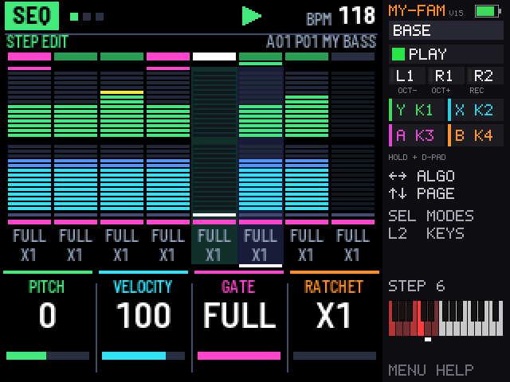
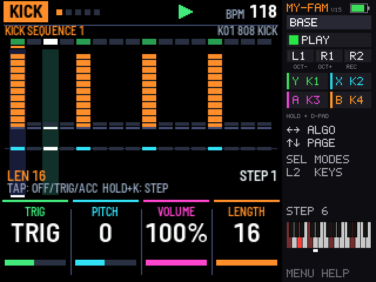
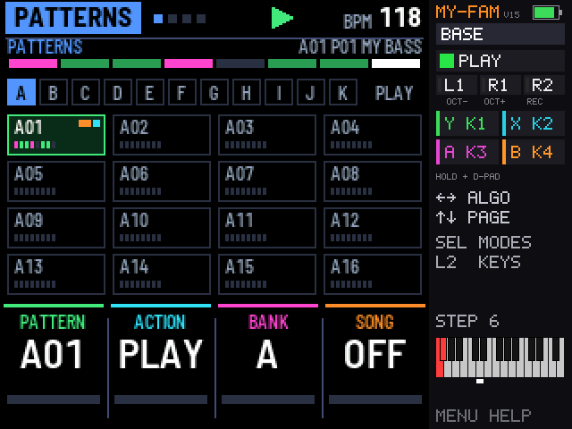
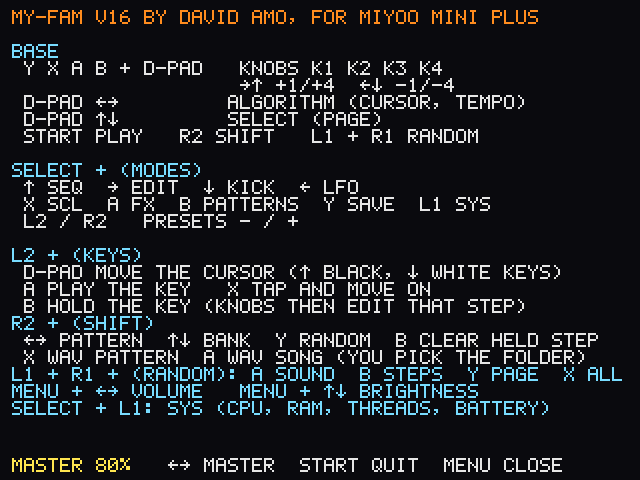

# MY-FAM

**A drum synth and 16-step sequencer for the Miyoo Mini Plus, by David Amo.**

MY-FAM is an app for the **Miyoo Mini Plus** handheld. Right now it is tested on **Allium OS** (Allium v1.0.2).
Other systems for the console (OnionOS and others) are not supported yet.

 
 

Promo video: [YouTube 16:9](docs/promo/MY-FAM_promo_youtube_16x9.mp4) · [Instagram reel 9:16](docs/promo/MY-FAM_promo_reel_9x16.mp4)

> [!WARNING]
> Beta software (MY-FAM v16). Provided "as is", without warranty of any kind (MPL-2.0, sections 6 and 7).
> Keep a copy of `my-fam.flash` if your patterns matter to you.

## What it does

- **SYNTH**: a voice with two oscillators (16 wave types each), hard sync, FM, noise, a ladder or state-variable
  filter, three envelopes, glide, and an 8-cable patch bay (**LFO** page).
- **KICK**: a drum synth with its own 16-step sequence (pitch, volume, condition, ratchet and nudge on every step).
- **SEQ**: 16 steps with parameter locks, step conditions, ratchets, swing and nudge.
- **PATTERNS**: 176 patterns in 11 banks, each with its own sound, and a 32-slot song.
- **FX**: compressor, stutter, delay, reverb, DJ filter and limiter.
- **SCL**: 16 scales; random pages; presets and projects (**SAVE**).
- **SYS**: the app's and the system's CPU and memory, the threads, the sound, the battery.

## Install

1. Download [`releases/MY-FAM-v16.zip`](releases/MY-FAM-v16.zip) and unzip it.
2. Copy the folder `Apps/MY-FAM.pak` to `/mnt/SDCARD/Apps/` on the SD card.
3. Start **MY-FAM** from Apps in Allium.

**Copying over the network (FTP, e.g. FileZilla): use binary mode.** Sent as text, the program arrives damaged and
closes at once; `log.txt` then says `checksum WRONG`.

Your patterns, sounds and projects are saved by themselves in `MY-FAM.pak/my-fam.flash`. The log of the last run is
`MY-FAM.pak/log.txt`.

## Screen

The main screen on the left; on the right a side panel with the version, the battery, the **control layer** that is
active (BASE, MODES, KEYS, SHIFT, RANDOM), PLAY, the L1 / R1 / R2 lights, what the buttons do in that layer, and the keyboard
(16 white keys for the steps, 11 black ones) with its lights and the key cursor.

 

## Controls

| Layer | Buttons | Does |
| --- | --- | --- |
| BASE | Y / X / A / B held + D-pad | knobs K1 / K2 / K3 / K4 (right, up: +; left, down: -; up and down: 4 at a time) |
| | D-pad left / right | cursor, step (tempo where it applies) |
| | D-pad up / down | page |
| | START | PLAY / STOP |
| MODES (SELECT held) | up / right / down / left | SEQ / EDIT / KICK / LFO |
| | X / A / B / Y | SCL / FX / PATTERNS / SAVE |
| | L1 | SYS |
| | L2 / R2 | presets - / + |
| KEYS (L2 held) | D-pad | the key cursor (up: black keys, down: white keys) |
| | A | plays the key while held |
| | X | taps the key and moves on |
| | B | holds the key until B again (the knobs then edit that step: parameter locks) |
| SHIFT (R2 held) | D-pad left / right | previous / next pattern |
| | D-pad up / down | 16 patterns on / back (a bank) |
| | Y | the RANDOM pages |
| | B | clears the held step (KEYS + B) |
| | X / A | WAV of the pattern / of the song: pick a folder first (below) |
| RANDOM (L1 + R1 held) | A / B / Y / X | random sound / steps / this page / all |
| MENU | | help; there left / right set MASTER, START quits (saving), MENU closes |

L1 and R1 no longer change octaves: use the SCALE page for that. MENU + D-pad stays Allium's: volume (left / right)
and brightness (up / down). Pattern changes with SHIFT go through the normal pattern queue and never run a
PATTERNS copy / paste / clear command.



## Export WAV

**R2 + X** renders the current pattern, **R2 + A** the song (one pass of its filled slots; with none, nothing is
written). First a folder picker opens, starting in the folder used last time (or the SD card's root):

- **UP / DOWN** pick a line (**L1 / R1** a page at a time), **A** or **RIGHT** opens a folder, **B** or **LEFT** goes
  up, **START** or `[ SAVE HERE ]` saves in the folder shown, `[ NEW FOLDER ]` makes `MY-FAM WAV` (or
  `MY-FAM WAV 2`, ...) and goes into it, **MENU** closes without saving.
- The file is `my-fam-pattern-001.wav` or `my-fam-song-001.wav` (the next free number in that folder): 44.1 kHz,
  stereo, 16-bit, with 2 seconds of effects tail. A pattern is rendered until its synth and kick sequences line up
  again (at most 16 bars).
- While it renders (in real time, and you hear it) the side panel shows **WAV n.nS** in red; then **SAVED** in green.
  Do not quit meanwhile. It is a stereo mix, not separate synth / kick tracks.
- The folder used is remembered in `MY-FAM.pak/my-fam.cfg`. `MYFAM_WAV_ROOT` in `settings.sh` changes where the
  picker starts and how far up it goes (default `/mnt/SDCARD`).

## Settings

An optional `settings.sh` next to `launch.sh`, with any of:

```sh
export MYFAM_ROTATE=0     # the picture upside down? do not turn it
export MYFAM_AHEAD=6144   # sound crackles? more sound ahead (more latency)
export MYFAM_FPS=20       # fewer screen frames a second
export MYFAM_STATS=0      # no CPU / RAM readings
export MYFAM_WAV_ROOT=/mnt/SDCARD/Music   # where the WAV folder picker starts
```

## Build

```sh
python3 tools/build.py fam --miyoo-test                     # the test runner, on this machine (cc, zlib)
cd OUTDIR && MYFAM_WAV_ROOT=. ~/my-fam/fam/build/miyoo/my-fam_test ~/my-fam/miyoo/tests/basic.txt .
                                                            # "0 failure(s)"; screenshots and WAVs in OUTDIR
                                                            # (miyoo/tests/*.txt: basic, v16_controls, v16_patterns,
                                                            # v16_random_chords, v16_wav; package.sh runs them all)

TOOLCHAIN=... SDL_INCLUDE=... SDL_LIB=... miyoo/package.sh  # the app: dist/MY-FAM-vN.zip
```

`miyoo/package.sh` says what each variable is: an `arm-linux-gnueabihf` GCC with an old glibc (the one in
[raspberrypi/tools](https://github.com/raspberrypi/tools) works), SDL 1.2's headers and Allium's `libSDL-1.2.so.0`
to link against (the app uses the console's own; it is not shipped).

How it runs: the app (`fam/`) runs on a host layer (`host/`, `device/`, `include/`, `lib/`) as if on its own
hardware; `miyoo/myfam_miyoo.c` gives it the Miyoo's buttons, screen and sound through SDL 1.2, and
`miyoo/pak/launch.sh` starts it in Allium (Allium's own SDL, the sound through its audioserver).

## Licence and credits

MY-FAM is **MPL-2.0** (`LICENSE`). Copyright (C) 2026 David Amo for MY-FAM's own code (`fam/`, `miyoo/`).

MY-FAM is built on [fm1-base](https://github.com/charlesvestal/fm1-base) (MPL-2.0) by Charles Vestal, Leo Kuroshita
and others: see [CREDITS.md](CREDITS.md) and [LICENSING.md](LICENSING.md). The screen fonts are Barlow
(The Barlow Project Authors) and Terminus (Dimitar Toshkov Zhekov), SIL OFL 1.1 (`assets/fonts/`).

Miyoo, Allium and M-VAVE are their owners' names; MY-FAM is not made or endorsed by them.
