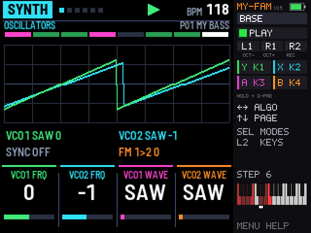
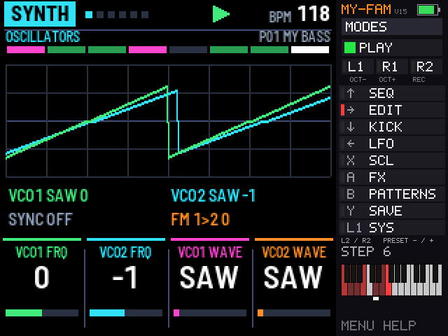
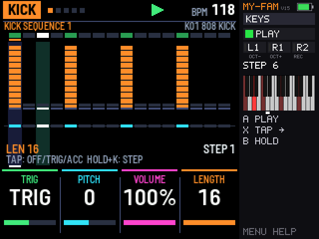

# My-FAM

**A drum synth and 16-step sequencer for the Miyoo Mini Plus, by David Amo.**

My-FAM is an app for the **Miyoo Mini Plus** handheld. Right now it is tested on **Allium OS** (Allium v1.0.2).
Other systems for the console (OnionOS and others) are not supported yet.

 
 

> [!WARNING]
> Beta software (My-FAM v15). Provided "as is", without warranty of any kind (MPL-2.0, sections 6 and 7).
> Keep a copy of `my-fam.flash` if your patterns matter to you.

## What it does

- **SYNTH**: a voice with two oscillators (16 wave types each), hard sync, FM, noise, a ladder or state-variable
  filter, three envelopes, glide, and an 8-cable patch bay (**LFO** page).
- **KICK**: a drum synth with its own 16-step sequence (pitch, volume, condition, ratchet and nudge on every step).
- **SEQ**: 16 steps with parameter locks, step conditions, ratchets, swing and nudge.
- **PATTERNS**: 176 patterns in 11 banks, each with its own sound, and a 32-slot song.
- **FX**: compressor, stutter, delay, reverb, DJ filter and limiter.
- **SCL**: 16 scales; random pages; presets and projects (**SAVE**).
- **SYS**: the app's and the system's CPU and memory, the threads, the sound, the battery.

## Install

1. Download `My-FAM-vN.zip` (Releases) and unzip it.
2. Copy the folder `Apps/My-FAM.pak` to `/mnt/SDCARD/Apps/` on the SD card.
3. Start **My-FAM** from Apps in Allium.

**Copying over the network (FTP, e.g. FileZilla): use binary mode.** Sent as text, the program arrives damaged and
closes at once; `log.txt` then says `checksum WRONG`.

Your patterns, sounds and projects are saved by themselves in `My-FAM.pak/my-fam.flash`. The log of the last run is
`My-FAM.pak/log.txt`.

## Screen

The main screen on the left; on the right a side panel with the version, the battery, the **control layer** that is
active (BASE, MODES, KEYS), PLAY, the L1 / R1 / R2 lights, what the buttons do in that layer, and the keyboard
(16 white keys for the steps, 11 black ones) with its lights and the key cursor.

 

## Controls

What a button does is decided when it goes down: hold L1 or R1 first, then the rest, for the OCT combinations.

| Layer | Buttons | Does |
| --- | --- | --- |
| BASE | Y / X / A / B held + D-pad | knobs K1 / K2 / K3 / K4 (right, up: +; left, down: -; up and down: 4 at a time) |
| | D-pad left / right | cursor, step (tempo where it applies) |
| | D-pad up / down | page |
| | START | PLAY / STOP |
| | L1 / R1 / R2 | OCT- / OCT+ / REC |
| MODES (SELECT held) | up / right / down / left | SEQ / EDIT / KICK / LFO |
| | X / A / B / Y | SCL / FX / PATTERNS / SAVE |
| | L1 | SYS |
| | L2 / R2 | presets - / + |
| KEYS (L2 held) | D-pad | the key cursor (up: black keys, down: white keys) |
| | A | plays the key while held |
| | X | taps the key and moves on |
| | B | holds the key until B again (the knobs then edit that step: parameter locks; R2 clears it) |
| MENU | | help; there left / right set MASTER, START quits (saving), MENU closes |

MENU + D-pad stays Allium's: volume (left / right) and brightness (up / down).


## Settings

An optional `settings.sh` next to `launch.sh`, with any of:

```sh
export MYFAM_ROTATE=0     # the picture upside down? do not turn it
export MYFAM_AHEAD=6144   # sound crackles? more sound ahead (more latency)
export MYFAM_FPS=20       # fewer screen frames a second
export MYFAM_STATS=0      # no CPU / RAM readings
```

## Build

```sh
python3 tools/build.py fam --miyoo-test                     # the test runner, on this machine (cc, zlib)
fam/build/miyoo/my-fam_test miyoo/tests/basic.txt OUTDIR    # "0 failure(s)"; screenshots and a WAV in OUTDIR

TOOLCHAIN=... SDL_INCLUDE=... SDL_LIB=... miyoo/package.sh  # the app: dist/My-FAM-vN.zip
```

`miyoo/package.sh` says what each variable is: an `arm-linux-gnueabihf` GCC with an old glibc (the one in
[raspberrypi/tools](https://github.com/raspberrypi/tools) works), SDL 1.2's headers and Allium's `libSDL-1.2.so.0`
to link against (the app uses the console's own; it is not shipped).

How it runs: the app (`fam/`) runs on a host layer (`host/`, `device/`, `include/`, `lib/`) as if on its own
hardware; `miyoo/myfam_miyoo.c` gives it the Miyoo's buttons, screen and sound through SDL 1.2, and
`miyoo/pak/launch.sh` starts it in Allium (Allium's own SDL, the sound through its audioserver).

## Licence and credits

My-FAM is **MPL-2.0** (`LICENSE`). Copyright (C) 2026 David Amo for My-FAM's own code (`fam/`, `miyoo/`).

My-FAM is built on [fm1-base](https://github.com/charlesvestal/fm1-base) (MPL-2.0) by Charles Vestal, Leo Kuroshita
and others: see [CREDITS.md](CREDITS.md) and [LICENSING.md](LICENSING.md). The screen fonts are Barlow
(The Barlow Project Authors) and Terminus (Dimitar Toshkov Zhekov), SIL OFL 1.1 (`assets/fonts/`).

Miyoo, Allium and M-VAVE are their owners' names; My-FAM is not made or endorsed by them.
